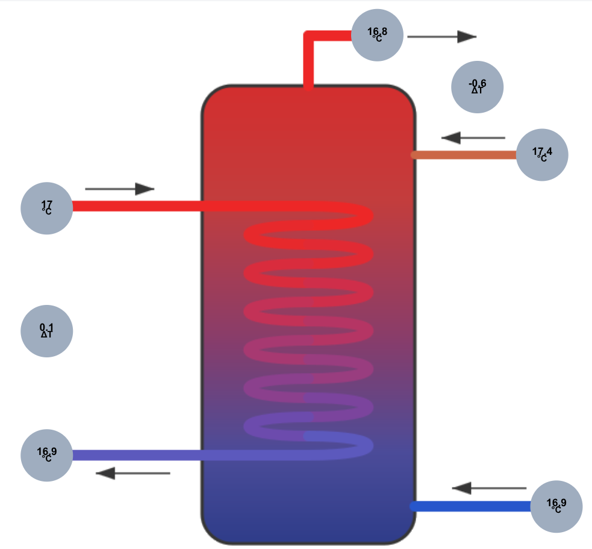
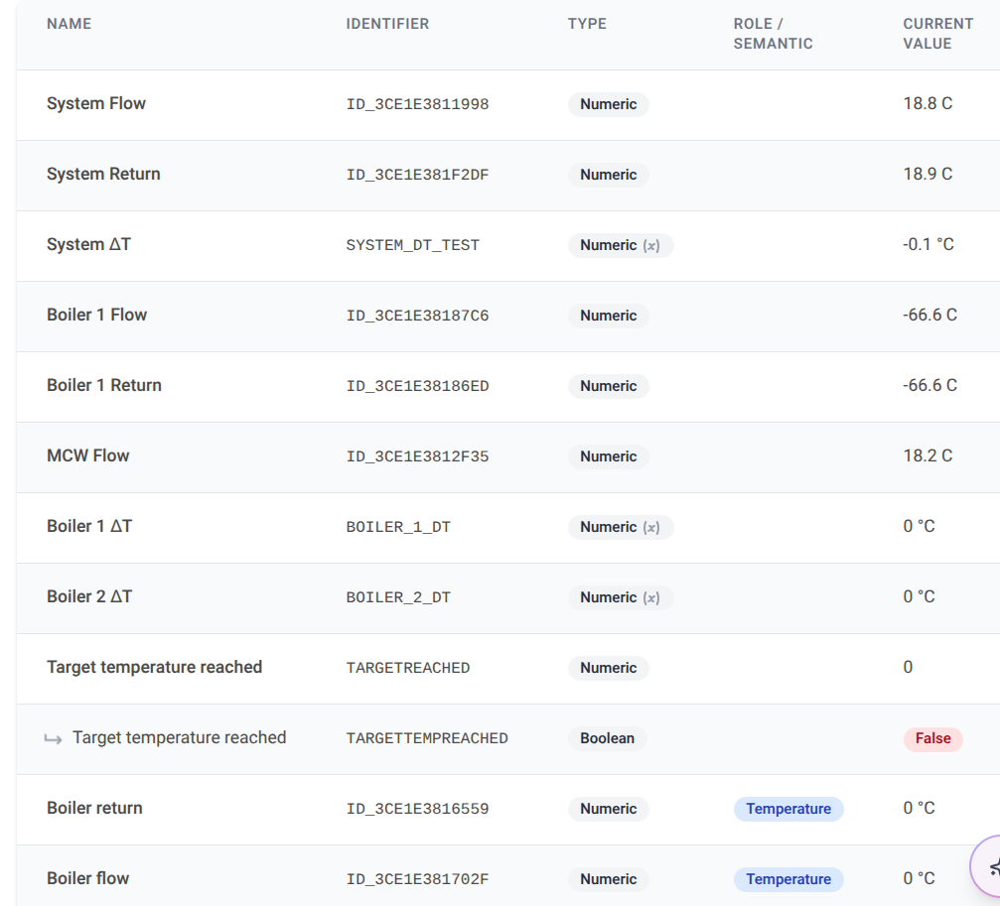

# Calorifier Temperature Logger

ESPHome firmware for a small logger that monitors a calorifier (hot water cylinder) with five DS18B20 probes. Every 5 minutes it reads all five at the same moment and publishes them to the [flespi](https://flespi.io) MQTT broker. Datacake picks the readings up from there for dashboards. The unit also serves a local web UI.



## Hardware

| Part | Notes |
|---|---|
| M5Stack AtomS3 Lite | ESP32-S3FN8, 8 MB flash, built-in WS2812 RGB LED on GPIO35 |
| DS2484 I2C→1-Wire bridge | Connected to the Grove port: SDA = GPIO2, SCL = GPIO1, I2C address `0x18` |
| 5× DS18B20 | 3-wire (not parasite power), daisy-chained on one 1-Wire bus |

The DS2484's active pull-up is enabled and strong pull-up is disabled. Check that the DS2484 board has its own I2C pull-up resistors, because the Grove port doesn't provide any.

### Sensors

| Sensor | Label digits | 1-Wire address | MQTT object id | Datacake field |
|---|---|---|---|---|
| DHW Flow | 11998 | `0x583ce1e381199828` | `dhw_flow` | `ID_3CE1E3811998` (System Flow) |
| DHW Return | 1f2df | `0x023ce1e381f2df28` | `dhw_return` | `ID_3CE1E381F2DF` (System Return) |
| Boiler Flow | 1702f | `0x383ce1e381702f28` | `boiler_flow` | `ID_3CE1E381702F` |
| Boiler Return | 16559 | `0xbc3ce1e381655928` | `boiler_return` | `ID_3CE1E3816559` |
| MCW In | 12f35 | `0x563ce1e3812f3528` | `mcw_in` | `ID_3CE1E3812F35` (MCW Flow) |

Datacake field IDs use the old Tasmota format: `ID_` plus the middle 12 hex digits of the 1-Wire address (the address minus its first and last bytes). This keeps the history from the previous Tasmota logger.

To add or replace a probe, flash the unit and look for the "Found devices" list in the boot log (`make logs`). Then update the `addr_*` substitutions at the top of [`calorifier-logger.yaml`](calorifier-logger.yaml).

## Behaviour

- **Polling:** one shared timer (`poll_interval`, 5 min) triggers all five probes together, so they convert at the same moment and report within ~100 ms of each other. This keeps flow/return ΔT readings consistent. Each sensor has `update_interval: never` on purpose.
- **WiFi:** two networks are configured, and the unit joins whichever is in range (the stronger one if both are). If neither is reachable, it starts a fallback hotspot named `calorifier-logger` with a captive portal after about a minute.
  - Credentials entered through the portal *replace* both compiled-in networks, and they survive WiFi updates. Use the portal only as a last resort.
- **Status LED** (about 10% brightness, set by `led_brightness`):
  - 🟢 green: WiFi and MQTT connected
  - 🟣 magenta: WiFi connected, MQTT not
  - 🔵 blue: no WiFi
- **Web UI:** `http://calorifier-logger.local/` (user `admin`, password `web_password`). Shows live readings and logs. The page's files are built into the firmware, so it works without internet access.
- **Watchdogs:** the unit reboots after 15 minutes without WiFi, or 15 minutes without MQTT (ESPHome defaults). The firmware has no Home Assistant API.

## MQTT

Broker: `mqtt.flespi.io:1883` (plain, not TLS). The flespi token is the username and the password is empty. Home Assistant discovery and MQTT log forwarding are disabled.

| Topic | Payload |
|---|---|
| `calorifier-logger/sensor/<object_id>/state` | Temperature in °C as a plain number, e.g. `17.875`. Retained. |
| `calorifier-logger/status` | `online` / `offline` (birth/last-will message) |
| `calorifier-logger/sensor/wifi_signal/state` | WiFi signal strength in dBm |
| `calorifier-logger/sensor/uptime/state` | Seconds since boot |
| `calorifier-logger/sensor/ip_address/state` | Current IP |
| `calorifier-logger/button/restart/command` | Publish `PRESS` to reboot the unit |

Subscribe to `calorifier-logger/#` to see everything.

On port 1883 the flespi token is sent unencrypted, so limit the token's permissions to MQTT publishing.

## Datacake

The Datacake MQTT integration subscribes to `calorifier-logger/sensor/+/state` and uses [`datacake/decoder.js`](datacake/decoder.js). The decoder:

- maps each topic's object id to its `ID_<serial>` field
- ignores `nan` readings (failed probe) and diagnostic topics
- sets `TARGETREACHED` (1/0) when the target sensor is at or above `TARGETTEMP`. The target sensor is the `TARGETSENSOR` configuration value; if that's not set, it defaults to DHW Flow.



The ΔT fields (`SYSTEM_DT_TEST`, `BOILER_1_DT`, `BOILER_2_DT`) are calculated in Datacake. `Boiler 1 Flow/Return` (`…87C6`, `…86ED`) belong to old probes from the previous Tasmota setup and aren't on this bus.

## Toolchain

ESPHome runs in a project-local virtualenv managed by [uv](https://docs.astral.sh/uv/).

```bash
make setup                                   # create .venv, install ESPHome, create secrets.yaml
make config                                  # validate the config
make upload                                  # build + flash over USB (/dev/ttyACM0)
make upload DEVICE=calorifier-logger.local   # build + flash over WiFi (or use the IP)
make logs                                    # USB serial logs
```

- `secrets.yaml` is git-ignored. Copy [`secrets.example.yaml`](secrets.example.yaml) and fill it in. Check there's no trailing whitespace in the SSIDs.
- To change a setting for one build without editing the YAML: `.venv/bin/esphome -s poll_interval 5s run calorifier-logger.yaml --device calorifier-logger.local --no-logs`
- **After a WiFi update, leave the unit running for at least 60 s before resetting or power-cycling it.** New firmware is only marked good after a minute of running. An earlier reset makes the bootloader quietly roll back to the previous build.
- WiFi updates only work from a machine on the same network as the unit (or over a VPN to it).
- If `ota_password` changes, the next flash must be over USB, because the device still has the old password.
- If the USB port doesn't appear, hold the side button for about 2 s to enter download mode.

## Files

| Path | Purpose |
|---|---|
| `calorifier-logger.yaml` | ESPHome configuration |
| `secrets.example.yaml` | Template for `secrets.yaml` |
| `Makefile` | Setup, build, flash and log shortcuts |
| `datacake/decoder.js` | Datacake MQTT payload decoder |
| `docs/images/` | Datacake screenshots |
